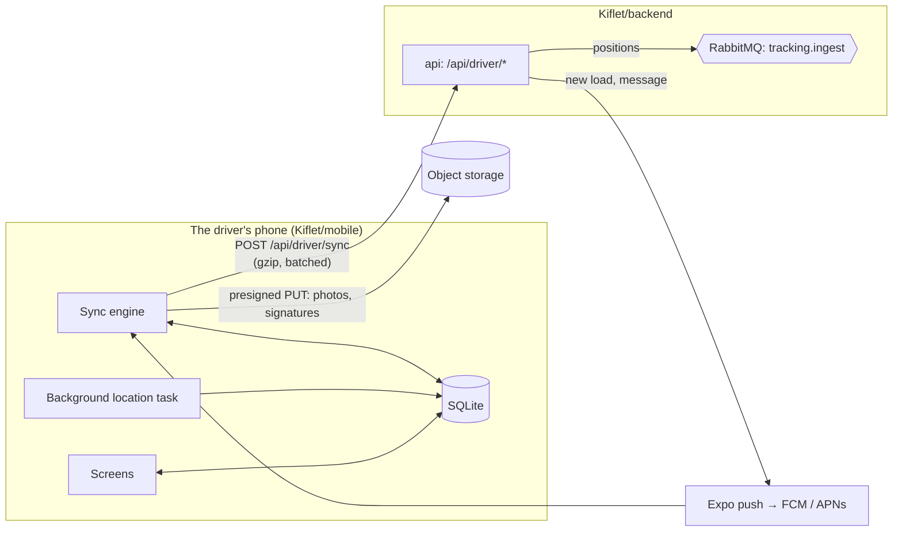
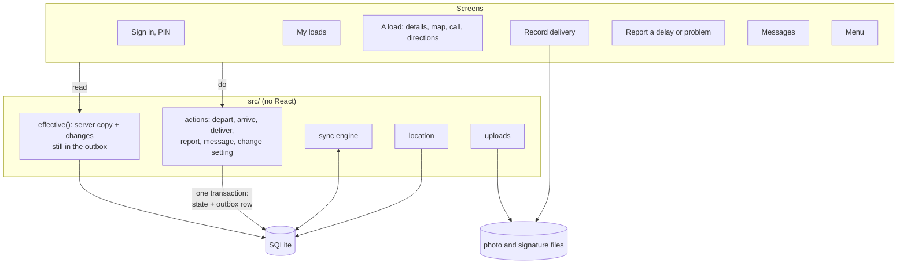
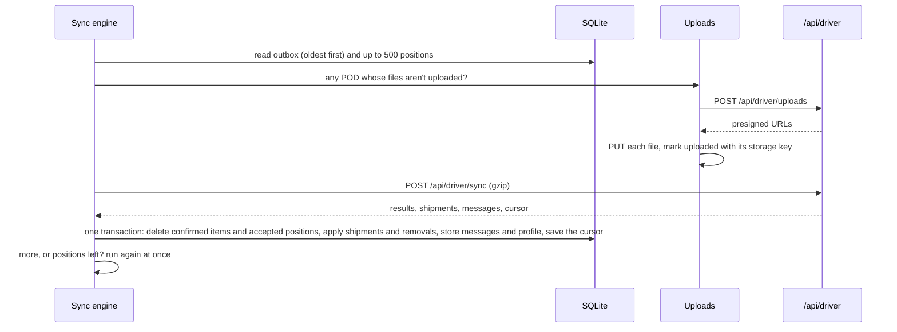

# Kiflet mobile: architecture

The driver app: a React Native app built with Expo, for Android first and
iOS from the same code. A driver sees their loads, reports departure,
delays, problems and arrival, records the delivery (recipient's name,
signature, photos, place), messages the office, and the phone records the
trip's GPS trail, all of it with or without signal.

It holds no business rules. What a driver may do next comes from the
backend (`/api/driver/config`); the backend decides every conflict. The
whole system is in
[Kiflet/backend `docs/architecture.md`](https://github.com/Kiflet/backend/blob/main/docs/architecture.md);
this document covers this repository's part. `docs/migration.md` is the
plan for replacing today's driver PWA with it.

Contents:

1. [Where it sits](#1-where-it-sits)
2. [Stack](#2-stack)
3. [Inside the app](#3-inside-the-app)
4. [The local database](#4-the-local-database)
5. [The outbox and the sync](#5-the-outbox-and-the-sync)
6. [GPS](#6-gps)
7. [Proof of delivery and uploads](#7-proof-of-delivery-and-uploads)
8. [Push notifications](#8-push-notifications)
9. [Configuration from the server](#9-configuration-from-the-server)
10. [Screens](#10-screens)
11. [Languages and look](#11-languages-and-look)
12. [Security](#12-security)
13. [Updates and versions](#13-updates-and-versions)
14. [Android specifics](#14-android-specifics)
15. [Testing](#15-testing)
16. [Repository layout](#16-repository-layout)

---

## 1. Where it sits



The backend's contract for this app is `api/openapi/driver.yaml` in
Kiflet/backend, published as `@kiflet/api`.

---

## 2. Stack

| Concern | Choice |
|---|---|
| Framework | React Native with Expo (managed workflow, development builds), TypeScript `strict` |
| Navigation | expo-router |
| Local database | expo-sqlite with Drizzle ORM and its migrations |
| Reading data | TanStack Query over SQLite queries (the screens never wait on the network) |
| App state | Zustand (session, sync status, connectivity) |
| Connectivity | @react-native-community/netinfo |
| Location | expo-location with expo-task-manager (background), Android foreground service |
| Background sync | expo-background-task (or expo-background-fetch) |
| Camera and photos | expo-camera, expo-image-picker, expo-image-manipulator (resize and compress) |
| Signature | react-native-signature-canvas |
| Files | expo-file-system |
| Secrets | expo-secure-store |
| Push | expo-notifications |
| Maps | react-native-maps (Google Maps on Android) or MapLibre React Native; same decision as the web's map tiles |
| Languages | i18next with react-i18next, `en` and `am` |
| API | `@kiflet/api` (openapi-fetch) |
| Crashes | Sentry (sentry-expo) |
| Builds and updates | EAS Build, EAS Update |
| Tests | Jest with React Native Testing Library; Maestro |

---

## 3. Inside the app



- **Screens read only SQLite**, through `effective()`: the server's copy of
  each load with the driver's changes not yet confirmed applied on top, and
  a "waiting to send" mark. This is today's `effective()` in the PWA's
  `sync.js`.
- **Every action writes locally first**: the new state and an outbox row,
  in one SQLite transaction, then asks the sync engine to run soon. The
  screen updates at once, signal or not.

---

## 4. The local database

Drizzle schema in `src/db/schema.ts`; migrations run at start, before any
screen.

| Table | Columns (main ones) | Notes |
|---|---|---|
| `shipments` | `id`, `tracking_number`, `ref`, `status`, `status_reason`, `priority`, origin and destination (address, lat, lng, precise), `customer_name`, `customer_phone`, `consignee_name`, `consignee_phone`, `cargo`, `pieces`, `weight_kg`, `vehicle`, `due_at`, `instructions`, `updated_at`, `json` (the server's whole object) | the server's copy, replaced on each sync |
| `outbox` | `client_id` (UUID, primary key), `kind` (`status`, `pod`, `message`, `setting`), `shipment_id`, `payload` (JSON), `created_at`, `attempts`, `last_error` | sent oldest first; deleted when the server confirms |
| `positions` | `client_id`, `shipment_id`, `lat`, `lng`, `accuracy_m`, `speed_kph`, `heading`, `battery`, `recorded_at` | sent in batches of 500; deleted when accepted |
| `files` | `id`, `outbox_client_id`, `kind` (`photo`, `signature`), `local_uri`, `bytes`, `storage_key`, `state` (`waiting`, `uploading`, `uploaded`) | a POD in the outbox waits until its files are uploaded |
| `messages` | `id`, `shipment_id`, `from` (office or driver), `body`, `at`, `read` | from the office, and the driver's own once confirmed |
| `settings` | `key`, `value`, `changed_at` | battery saver, vibrate on messages, keep the screen on while charging, share location, language |
| `meta` | `key`, `value` | sync cursor, last sync, server time offset, driver profile, config from the server, app version last migrated |

Space: delivered loads and their messages are deleted 7 days after
delivery; files as soon as the server confirms the POD. The menu shows the
space used, as the PWA's does.

---

## 5. The outbox and the sync

The protocol is the one the PWA uses today (`POST /api/v1/driver/sync`,
`SyncRequest` and `SyncResponse` in the backend's
`internal/service/sync.go`), moved to `/api/driver/sync`:

**Request:** `device_id`, `app_version`, `device_time`, `battery`,
`pending` (items waiting), `storage_kb`, `tracking_paused`,
`power_saving`, `settings` (changed since the last sync), `since` (the
cursor), and the items: `statuses`, `pods` (with storage keys for files),
`locations`, `messages`. Every item has its `client_id`.

**Response:** `server_time`, `cursor`, `results` (one per item: ok, or an
error with a code), `locations_stored`, `shipments` (changed),
`removed_shipment_ids`, `messages`, `driver` (profile and settings), and
`more` when there is more to fetch at once.



When it runs:

- soon after an action (under a second), as `scheduleSync(800)` today;
- every 60 s while the app is open (every 5 minutes in battery saver);
- when the network comes back (NetInfo);
- when a push arrives;
- in the background, as often as the OS allows (about every 15 minutes),
  and from the location task when positions pile up.

On failure it backs off (30 s, 1, 2, 5, 10 minutes, then every 10) and
shows the reason in the sync pill: no signal, weak signal, server not
reachable, signed out.

**Conflicts:** the server decides. When an item is refused (for example
the office cancelled the load while the phone was offline), the result
says why; the app removes the item, takes the server's copy of the load,
and tells the driver in plain words. This is section 5 of the backend's
`docs/E2E_TEST_GUIDE.md`, and its checks apply here unchanged.

**Idempotency:** the server ignores a `client_id` it has already applied,
so sending twice after a lost response is harmless.

---

## 6. GPS

The rules are today's (`static/driver/gps.js` in the backend):

| Situation | Positions |
|---|---|
| Moving | one a minute, high accuracy |
| Slow or in town | one every 5 minutes |
| Parked for 10 minutes (moved less than 75 m) | GPS off; a check every 5 minutes notices when the truck moves again |
| Battery saver (chosen, or battery under 20% and not charging) | coarse location, one every 15 minutes; parked checks every 15 |
| No active load, or location sharing off | nothing |

How it runs on the phone:

- `Location.startLocationUpdatesAsync` with a task defined by
  `TaskManager.defineTask`, `accuracy` and `timeInterval` /
  `distanceInterval` set from the table, and on Android a **foreground
  service** with a permanent notification ("Kiflet is recording your
  trip"), so the system doesn't stop it with the screen off.
- The task only writes the position to SQLite, tagged with the active
  load. It never calls the network; the sync engine sends.
- Started when the driver has a load on the road or assigned and sharing
  is on; stopped when the last load is delivered or sharing is turned off.
- The backend draws gaps honestly: if the phone was quiet for over 20
  minutes while the truck moved, the trail shows a dashed line with how
  long (Kiflet/backend PR #46). The app's job is to keep those gaps rare.

---

## 7. Proof of delivery and uploads

1. The driver enters the recipient's name (and phone, optional), takes up
   to `max_photos` photos (3 today), and the recipient signs.
2. The app takes a fresh position (10 s timeout; a fix up to 10 minutes
   old is accepted, as `fixForEvent` does today) and compares it with the
   destination. Further than the tolerance, it warns and asks for a reason
   from `location_reasons`.
3. Photos are resized to 1600 px on the long side and compressed (JPEG,
   about 300 KB); the signature is saved as PNG.
4. One transaction: the load becomes delivered locally, a `pod` outbox
   row, and the `files` rows.
5. Uploads go through presigned URLs, resumable, retried; the POD is sent
   in a sync only once its files are uploaded, carrying their storage keys.
6. Files are deleted when the server confirms the POD.

---

## 8. Push notifications

- At sign-in, the app registers its Expo push token with
  `POST /api/driver/push-token` (and again when it changes).
- Pushes from the backend: a new load, a load changed or cancelled, a
  message from the office. Each carries only an ID and a short text; the
  app syncs to get the content, so nothing is lost when a push is.
- Tapping a push opens the load or the messages. Vibration on messages
  follows the driver's setting.

---

## 9. Configuration from the server

`GET /api/driver/config` (today `/api/v1/driver/config`), fetched at start
and stored in `meta`, so the app works offline with the last copy:

`app_name`, `version`, `sms_number` (for reporting by SMS without data),
`statuses` (code and label), `transitions` (what a driver may change each
status to), `pod_from` (statuses a delivery can be recorded from),
`delay_reasons`, `issue_reasons`, `location_reasons`, `max_photos`,
`tile_url`, `tile_credit`, and from the new API `min_app_version`.

The buttons on a load's screen come from `transitions` for its effective
status. The app has no list of statuses of its own.

---

## 10. Screens

| Screen | What it does |
|---|---|
| Sign in | phone and PIN; language choice; "forgot PIN" (code by SMS); the SMS fallback explained |
| Choose a PIN | forced after a reset, or from the menu |
| My loads | active loads, then "finished this week"; priority marks; the sync pill; pull to sync |
| A load | status and reference, the actions allowed now (large buttons), pickup and drop-off with directions, the mini-map (you and the drop-off), the customer and a call button, cargo and vehicle, instructions, messages for this load, the SMS fallback for this load |
| Record delivery | recipient, photos, signature, the location check and reason |
| Report a delay or problem | reason from the server's list, a note |
| Messages | the office's messages and replies |
| Menu | the driver, company and truck; language; battery saver; vibrate on messages; keep the screen on while charging; share location; sync now and when last synced; storage used and clearing it; change PIN; sign out; call the office; version |

---

## 11. Languages and look

- English and Amharic, chosen at sign-in and in the menu; the words come
  from today's `static/driver/text.js` (about 150 strings), moved to
  `src/i18n/en.json` and `am.json` with a test that the keys match. The
  Amharic still needs the native speaker's review that the backend's
  ROADMAP asks for.
- The look is the dashboard's Desk and Night colours, at the driver app's
  larger sizes (48–60 px buttons, 17 px text) for one hand and bright sun.
  The tokens are the backend's `static/driver/app.css` (they match the
  web's); Geist and Noto Sans Ethiopic bundled.
- Follows the phone's light or dark setting.

---

## 12. Security

- The driver's token (from phone and PIN) in expo-secure-store; never in
  SQLite or logs. One token per device, revocable from the dashboard
  (the driver's page) and by "sign out".
- A `401` from the API signs the driver out on the phone but keeps the
  outbox, which is sent after the next sign-in by the same driver. A
  different driver signing in on the phone gets an empty database.
- The SQLite file stays in the app's private storage. Photos are stored
  in the app's private directory, not the gallery.
- HTTPS only (Android `usesCleartextTraffic` off).

---

## 13. Updates and versions

- JavaScript changes reach phones through **EAS Update** on the next
  start, without the store. Native changes (permissions, SDK upgrades,
  new native modules) need a store release.
- Each request carries `X-App-Version`. The backend answers `426 Upgrade
  Required` below its minimum, and the app shows an update screen (with
  the Play link and the APK link) while keeping the outbox.
- The backend serves the last two releases (or 90 days) of the driver
  API.
- Distribution: Google Play (internal, closed, then production tracks),
  and a signed APK on the website for phones without Play. iOS through
  TestFlight and the App Store when wanted.

---

## 14. Android specifics

- Permissions: precise and background location (asked in two steps, with
  an explanation screen first, as Play's policy requires), camera,
  notifications (Android 13+), foreground service (location type).
- Play Console: the background location declaration and a short video of
  the feature; the data safety form (location, photos, phone numbers).
- Battery optimisation: some makers (Tecno, Itel, Infinix, Xiaomi) stop
  background apps aggressively. The app detects it where possible and
  shows the driver how to exempt Kiflet; the pilot checks the phones
  drivers actually use.
- Minimum Android version: whatever Expo's SDK supports (Android 7+ at the
  time of writing); test on a cheap phone with 2 GB of memory.

---

## 15. Testing

| Kind | Tool | What |
|---|---|---|
| Unit | Jest | the outbox, `effective()`, the sync engine against a fake API (lost responses, refused items, `more`, backoff), GPS interval choice, the en/am key check |
| Components | React Native Testing Library | each screen's states: offline, pending, refused, empty |
| End to end | Maestro on an Android emulator, against staging | sign in, depart, go offline, deliver with photo and signature, come back online, see the delivery on the dashboard; a conflict (cancelled while offline); a forced update |
| On real phones | the pilot | cheap Android, weak signal, screen locked for hours |

---

## 16. Repository layout

```
app/                     expo-router screens
  (auth)/login.tsx  (auth)/pin.tsx
  (app)/index.tsx  (app)/shipments/[id].tsx  (app)/shipments/[id]/deliver.tsx
  (app)/shipments/[id]/report.tsx  (app)/messages.tsx  (app)/menu.tsx
  _layout.tsx
src/
  db/                    schema.ts, migrations, queries
  sync/                  engine, outbox, effective(), backoff
  location/              task, intervals, battery saver
  uploads/               presigned uploads
  push/                  token registration, handlers
  api/                   client over @kiflet/api, version header
  i18n/                  en.json, am.json
  ui/                    tokens, components (buttons, cards, badges, pill)
  state/                 Zustand stores
assets/                  icon, splash, fonts
app.config.ts            Expo config (package et.kiflet.driver or com.kiflet.driver, permissions, plugins)
eas.json                 build profiles
.maestro/                end-to-end flows
docs/                    this file, migration.md
```
